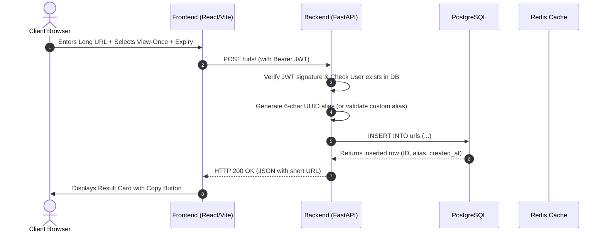
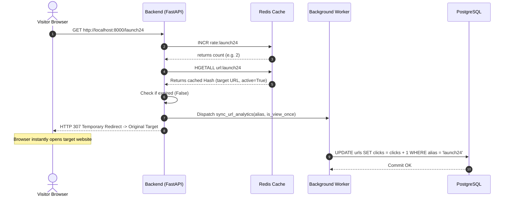

# URL Shortener: End-to-End Project Documentation & Feature Implementation Guide

> A comprehensive, full-stack architectural breakdown of the **URL Shortener Application** built with **FastAPI, PostgreSQL, Redis, and React (Vite + Tailwind CSS)**.
> This document details every user-facing and backend feature, explaining the complete end-to-end journey from the browser request down to the database row and cache entry.

---

## Table of Contents
1. [Project Overview & System Architecture](#1-project-overview--system-architecture)
2. [End-to-End Technology Stack](#2-end-to-end-technology-stack)
3. [Feature Breakdown & Implementation Deep Dive](#3-feature-breakdown--implementation-deep-dive)
   - [Feature 1: User Authentication & Session Security](#feature-1-user-authentication--session-security)
   - [Feature 2: Short Link Generation (Random & Custom Aliases)](#feature-2-short-link-generation-random--custom-aliases)
   - [Feature 3: Dynamic Expiration (TTL & Automatic Link Inactivation)](#feature-3-dynamic-expiration-ttl--automatic-link-inactivation)
   - [Feature 4: Ephemeral "View-Once" ("Burn After Reading") Links](#feature-4-ephemeral-view-once-burn-after-reading-links)
   - [Feature 5: Ultra-Fast Redirection with Two-Tier Caching (Redis + DB)](#feature-5-ultra-fast-redirection-with-two-tier-caching-redis--db)
   - [Feature 6: Atomic Fixed-Window Rate Limiting](#feature-6-atomic-fixed-window-rate-limiting)
   - [Feature 7: Asynchronous Analytics & Click Tracking](#feature-7-asynchronous-analytics--click-tracking)
   - [Feature 8: Real-Time Link Management Dashboard (Edit, Delete, Copy)](#feature-8-real-time-link-management-dashboard-edit-delete-copy)
4. [Data Models & Schema Design](#4-data-models--schema-design)
5. [End-to-End Data Flow Scenarios](#5-end-to-end-data-flow-scenarios)
6. [Summary of Production Edge-Cases Handled](#6-summary-of-production-edge-cases-handled)

---

## 1. Project Overview & System Architecture

The application is a modern, enterprise-grade URL Shortening and Link Management platform. It allows users to convert long web URLs into compact short links while applying sophisticated access control rules:
* Time-based automatic expiration.
* Self-destructing links ("view-once").
* Anti-abuse rate limiting per link.
* Non-blocking background click analytics.
* Instant cache-accelerated redirects.

### High-Level System Architecture

```
┌─────────────────────────────────────────────────────────────────────────┐
│                           FRONTEND (React SPA)                          │
│  - Vite + React 18 + Tailwind CSS                                       │
│  - Axios with JWT Interceptors & Session Management in localStorage    │
└────────────────────────────────────┬────────────────────────────────────┘
                                     │ HTTP REST Requests
                                     ▼
┌─────────────────────────────────────────────────────────────────────────┐
│                           BACKEND API (FastAPI)                         │
│  ├── CORS Middleware (Cross-Origin Resource Sharing)                     │
│  ├── OAuth2 JWT Bearer Authentication Dependency                        │
│  ├── Routers:                                                           │
│  │    ├── /auth      -> Token Issuance & Verification                    │
│  │    ├── /users     -> User Registration & Profile Data                │
│  │    ├── /urls      -> CRUD Operations for URLs                        │
│  │    └── /{alias}   -> High-Throughput Redirection Engine              │
│  └── Background Tasks Engine (Decoupled Analytics Sync)                 │
└──────────────────┬──────────────────────────────────────┬───────────────┘
                   │                                      │
                   ▼ Cache & Rate Limit                   ▼ Persistent Storage
┌────────────────────────────────────────┐ ┌──────────────────────────────┐
│              REDIS CACHE               │ │      POSTGRESQL DATABASE     │
│  - rate:{alias} -> Click Counter       │ │  - users table (Credentials) │
│  - url:{alias}  -> Hash Cache Data     │ │  - urls table (State & Stats)│
│  - Dynamic TTL Key Eviction            │ │  - Foreign Keys & Indexes    │
└────────────────────────────────────────┘ └──────────────────────────────┘
```

---

## 2. End-to-End Technology Stack

| Layer | Technology | Key Responsibility |
|---|---|---|
| **Frontend UI** | React 18, Vite, Tailwind CSS, Lucide Icons | Responsive single-page application (SPA), input validation, clipboard integration, dynamic state management. |
| **HTTP Client** | Axios | Custom interceptors attaching JWT Bearer tokens to outbound requests; centralized error normalization. |
| **Backend Framework** | FastAPI (Python 3.12+) | High-performance asynchronous REST API, OpenAPI automatic docs, dependency injection, and BackgroundTasks execution. |
| **Data Validation** | Pydantic v2 | Request/response schema validation, type enforcement, data serialization. |
| **Relational Database** | PostgreSQL 16+ | ACID-compliant persistent source of truth for users and URL metadata. |
| **ORM & Migrations** | SQLAlchemy 2.0 & Alembic | Declarative mapping, relationship lazy-loading/eager-loading, and database schema versioning. |
| **In-Memory Store** | Redis | Low-latency caching of URL redirect targets and atomic counter-based rate limiting. |
| **Security & Cryptography** | `pwdlib` (Argon2 / Bcrypt), `PyJWT` | Secure salted password hashing and stateless JWT token creation/verification. |

---

## 3. Feature Breakdown & Implementation Deep Dive

---

### Feature 1: User Authentication & Session Security

#### What It Does:
Allows users to register an account, securely log in, retain active sessions across browser reloads, and access protected URL management endpoints. A "One-Click Demo Account" is also provided on the frontend for instant testing.

#### How It Works End-to-End:
1. **Frontend**:
   - `AuthModal.jsx` collects user input (`name`, `email`, `password`).
   - For login, it submits `application/x-www-form-urlencoded` credentials to `POST /login` (conforming to OAuth2 password specification).
   - Upon success, the returned `access_token` and `email` are stored in `localStorage`.
   - `client.js` configures an Axios request interceptor:
     ```javascript
     api.interceptors.request.use((config) => {
       const token = localStorage.getItem('token');
       if (token) config.headers.Authorization = `Bearer ${token}`;
       return config;
     });
     ```
2. **Backend**:
   - In `app/routers/auth.py`, incoming passwords are verified against the stored hash using `pwdlib.PasswordHash.recommended().verify()`.
   - `app/oauth2.py` generates a signed JWT payload:
     `{"user_id": user.id, "exp": current_time + 15_minutes}`.
   - For every protected route, the dependency `get_current_user` extracts and decodes the JWT, verifies the cryptographic signature, and queries PostgreSQL (`SELECT * FROM users WHERE id = user_id`) to ensure the user exists and has not been deleted.

---

### Feature 2: Short Link Generation (Random & Custom Aliases)

#### What It Does:
Transforms long destination URLs (e.g., `https://my-domain.com/very/long/article?id=99283`) into a compact slug (e.g., `http://localhost:8000/a3f9c2`), with support for custom user-selected aliases.

#### How It Works End-to-End:
1. **Frontend**:
   - `UrlShortener.jsx` captures the destination URL and optional custom alias.
   - Dispatches a payload to `POST /urls/`:
     ```json
     {
       "original": "https://github.com",
       "alias": "my-repo",
       "expire_at": null,
       "active": true,
       "view_once": false
     }
     ```
2. **Backend**:
   - In `app/routers/urls.py` (`create_short_url`):
     - **URL Normalization**: If the URL lacks `http://` or `https://`, it automatically prepends `https://` to prevent invalid relative redirects.
     - **Auto-Generation & Collision Handling**: If no custom alias was supplied, `uuid.uuid4().hex[:6]` generates a 6-character random string. The system executes a database query inside a loop (`while check_url:`) to guarantee that the generated code is completely unique.
     - **Duplicate Check**: If a custom alias was supplied, the backend checks `db.scalar(...)`. If the alias already exists, it raises `HTTP 409 Conflict`.
     - **Persistence**: Inserts a new row into PostgreSQL and commits the transaction.
3. **Frontend Presentation**:
   - Receives the response and displays `UrlResultCard.jsx`, rendering the full clickable short URL and providing a one-click copy button.

---

### Feature 3: Dynamic Expiration (TTL & Automatic Link Inactivation)

#### What It Does:
Allows the creator of a link to pick a future date and time (`expire_at`). Once that point in time is reached, the link automatically deactivates and redirects return `HTTP 410 Gone`.

#### How It Works End-to-End:
1. **Frontend**:
   - An HTML5 `<input type="datetime-local" />` allows the user to select an expiration timestamp.
   - The timestamp is converted into an ISO-8601 UTC string (`new Date(expireAt).toISOString()`) and sent in the payload.
2. **Backend (Database & Cache Synchronization)**:
   - Stored in PostgreSQL with a timezone-aware column: `TIMESTAMP(timezone=True)`.
   - When cached in Redis, the system calculates a **bounded dynamic TTL**:
     ```python
     current_time = datetime.now(timezone.utc)
     ttl = 600
     if url.expire_at:
         seconds_left = int((url.expire_at - current_time).total_seconds())
         ttl = max(1, min(600, seconds_left))
     rconn.expire(cache_key, ttl)
     ```
   - **Why this is critical**: The Redis key self-evicts at the exact moment the link expires (capped at 600s), ensuring Redis memory is freed and users cannot access expired links from cache.
3. **Redirection Verification**:
   - Both the Redis cache check and the database check evaluate:
     `if expire_time < current_time: raise HTTPException(status_code=410, detail="URL not active!")`.
   - On detecting expiration, the backend marks `url.active = False` in the database and updates Redis.

---

### Feature 4: Ephemeral "View-Once" ("Burn After Reading") Links

#### What It Does:
Creates single-use links that instantly self-destruct after the very first successful redirection.

#### How It Works End-to-End:
1. **Frontend**:
   - The user toggles the "View-Once Link" switch in `UrlShortener.jsx`, sending `"view_once": true`.
2. **Backend (Cache-Bypass & Invalidation Mechanics)**:
   - *On Database Query (First Visitor)*:
     When the first user clicks the link:
     ```python
     if url.view_once:
         url.active = False
         url.clicks += 1
         db.commit()
         rconn.delete(f"url:{alias}")
         return RedirectResponse(url=url.original, status_code=307)
     ```
     The link is updated in PostgreSQL (`active = False`), committed immediately, and purged from Redis.
   - *On Cache Hits*:
     If the link had previously been cached, the redirect engine dispatches an asynchronous background task `sync_url_analytics(alias, is_view_once=True)`.
     The background worker updates PostgreSQL to `url.active = False` and executes:
     `rconn.delete(f"url:{alias}")` and `rconn.delete(f"rate:{alias}")`.
   - *Subsequent Visitors*:
     Any future attempt to open the link hits either:
     - Redis: `active == "False"` $\to$ returns `HTTP 410 Gone`.
     - PostgreSQL: `url.active == False` $\to$ returns `HTTP 410 Gone`.

---

### Feature 5: Ultra-Fast Redirection with Two-Tier Caching (Redis + DB)

#### What It Does:
Resolves short links in under 2 milliseconds by avoiding relational database queries for frequently accessed links.

#### How It Works End-to-End:
1. **Visitor Triggers Request**: A user or browser navigates to `GET http://localhost:8000/{alias}`.
2. **Tier 1: Redis Hash Lookup**:
   - The application checks Redis: `rconn.hgetall(f"url:{alias}")`.
   - **Cache Hit**:
     - Reads `original`, `active`, `view_once`, and `expire_at`.
     - Validates active status and expiration.
     - Spawns background analytics task.
     - Returns `HTTP 307 Temporary Redirect` immediately.
3. **Tier 2: PostgreSQL Fallback (Cache Miss)**:
   - If Redis returns an empty dict, queries PostgreSQL: `SELECT * FROM urls WHERE alias = :alias`.
   - If no row exists: raises `HTTP 404 Not Found`.
   - If row exists and is valid:
     - Populates Redis with `rconn.hset(...)`.
     - Applies dynamic TTL.
     - Increments click count.
     - Returns `HTTP 307 Temporary Redirect`.

---

### Feature 6: Atomic Fixed-Window Rate Limiting

#### What It Does:
Protects short URLs from automated scrapers, brute-force bots, and denial-of-service attempts by restricting each link to a maximum of **10 requests per 10-minute window**.

#### How It Works End-to-End:
1. Every incoming request to `GET /{alias}` executes before any DB or cache lookup:
   ```python
   rate_key = f"rate:{alias}"
   clicks = rconn.incr(rate_key, 1)

   if clicks == 1:
       rconn.expire(rate_key, 600)

   if clicks > 10:
       raise HTTPException(
           status_code=status.HTTP_429_TOO_MANY_REQUESTS,
           detail="Rate limit exceeded."
       )
   ```
2. **Atomicity Guarantee**:
   - `INCR` is an atomic single-operation Redis command. Even under thousands of concurrent requests, no race condition can bypass the counter.
   - Setting the 600s TTL *strictly when `clicks == 1`* ensures the 10-minute window starts on the first request and does not slide forward with subsequent traffic.

---

### Feature 7: Asynchronous Analytics & Click Tracking

#### What It Does:
Tracks the total number of visits per link without degrading redirection speed.

#### How It Works End-to-End:
1. **The Problem with Synchronous Writes**:
   - Running `UPDATE urls SET clicks = clicks + 1` synchronously on every redirect forces the client to wait for a database disk write lock, causing latency spikes and connection pool starvation.
2. **The Solution (`FastAPI.BackgroundTasks`)**:
   - On cache hit, the redirection response is returned immediately to the client.
   - FastAPI's background task runner invokes `sync_url_analytics`:
     ```python
     background_tasks.add_task(sync_url_analytics, alias=alias, is_view_once=view_once)
     ```
   - In the background worker:
     - Obtains a dedicated database session.
     - Atomically increments `url.clicks += 1`.
     - Commits the transaction and closes the session cleanly.

---

### Feature 8: Real-Time Link Management Dashboard (Edit, Delete, Copy)

#### What It Does:
Provides an interactive management interface for authenticated users to view link metrics, search their links, update destinations or aliases, and delete unwanted links.

```
Dashboard UI:
┌────────────────────────────────────────────────────────────────────────┐
│ [Total Links: 24]      [Active Links: 21]      [Total Clicks: 1,420]   │
├────────────────────────────────────────────────────────────────────────┤
│ [ 🔍 Search links by original URL or short alias...                  ] │
├──────────────┬──────────────────┬────────┬──────────┬─────────┬────────┤
│ Short URL    │ Original URL     │ Clicks │ Status   │ Expiry  │ Action │
├──────────────┼──────────────────┼────────┼──────────┼─────────┼────────┤
│ /launch-v2   │ https://prod...  │ 420    │ Active   │ Never   │ ✏️  🗑️  │
│ /a8f10b      │ https://docs...  │ 1      │ Burned   │ View-1x │ ✏️  🗑️  │
└──────────────┴──────────────────┴────────┴──────────┴─────────┴────────┘
```

#### How It Works End-to-End:
1. **Parallel Metric Hydration**:
   - In `Dashboard.jsx`, the frontend first calls `GET /urls/` to get the user's links.
   - Then runs `Promise.all()` calling `GET /urls/{id}` in parallel to fetch detailed metrics (click counts, active status, creation dates, view-once flags) without sequential blocking.
2. **Live Search Filtering**:
   - Client-side filtering allows users to instantly search across aliases or long URLs with zero network latency.
3. **Editing Links (`EditUrlModal.jsx`)**:
   - Dispatches `PUT /urls/{id}` with modified fields.
   - **Backend Cache Synchronization**:
     - In `app/routers/urls.py`, updates PostgreSQL.
     - If the alias was changed, the old Redis key (`url:{old_alias}`) is evicted immediately.
     - If active in Redis, the new metadata is synced to `url:{new_alias}` using `rconn.hset()`.
4. **Deleting Links**:
   - Dispatches `DELETE /urls/{id}`.
   - Backend deletes the PostgreSQL row and purges the Redis cache key `rconn.delete(f"url:{url.alias}")`.

---

## 4. Data Models & Schema Design

### PostgreSQL Relational Schema

```sql
-- Users Table
CREATE TABLE users (
    id SERIAL PRIMARY KEY,
    name VARCHAR NOT NULL,
    email VARCHAR UNIQUE NOT NULL,
    password VARCHAR NOT NULL
);

-- URLs Table
CREATE TABLE urls (
    id SERIAL PRIMARY KEY,
    original VARCHAR NOT NULL,
    alias VARCHAR UNIQUE NOT NULL,
    shortened VARCHAR UNIQUE NOT NULL,
    active BOOLEAN DEFAULT TRUE,
    view_once BOOLEAN DEFAULT FALSE,
    clicks INTEGER DEFAULT 0 NOT NULL,
    expire_at TIMESTAMP WITH TIME ZONE NULL,
    created_at TIMESTAMP WITH TIME ZONE DEFAULT NOW() NOT NULL,
    user_id INTEGER REFERENCES users(id) ON DELETE CASCADE NOT NULL
);

-- Indexing Strategy
CREATE INDEX ix_urls_alias ON urls (alias);
CREATE INDEX ix_urls_shortened ON urls (shortened);
```

### Redis In-Memory Key Structure

| Key Pattern | Redis Type | Fields / Value | Purpose |
|---|---|---|---|
| `url:{alias}` | **Hash** | `original`: String<br>`active`: "True"/"False"<br>`view_once`: "True"/"False"<br>`expire_at`: ISO-8601 String | Primary redirect cache. Read on every `GET /{alias}`. |
| `rate:{alias}` | **String (Int)** | Counter integer (e.g., `3`) | Sliding/fixed window request counter for rate limiting. |

---

## 5. End-to-End Data Flow Scenarios

### Scenario A: Creating a New Short URL


---

### Scenario B: Clicking a Short URL (Cache Hit Path)


---

## 6. Summary of Production Edge-Cases Handled

1. **Protocol Normalization Bug**: Fixed URL prefix check to prevent malformed strings like `https://https://site.com`.
2. **Cache-Miss Null Pointers**: Guarded against accessing `.original` or `.expire_at` on non-existent aliases prior to 404 validation.
3. **Timezone Offset Comparisons**: Properly preserved UTC timezone information when deserializing ISO-8601 strings from Redis cache to avoid comparing offset-naive and offset-aware datetimes.
4. **Stale Cache on Update/Delete**: Implemented cache eviction on `DELETE` and cache synchronization on `PUT`, ensuring edits take effect immediately.
5. **Rate-Limiter Key Typo**: Corrected namespace key formatting (`rate:{alias}`) so rate-limiting and expiration purge clean up reliably.
6. **Token-to-Database Integrity**: Ensured `get_current_user` validates that the user ID in the JWT still corresponds to an active account in PostgreSQL.
7. **HTTP Status Code Standards**: Upgraded duplicate conflicts from non-standard `226 IM Used` to `409 Conflict`.
